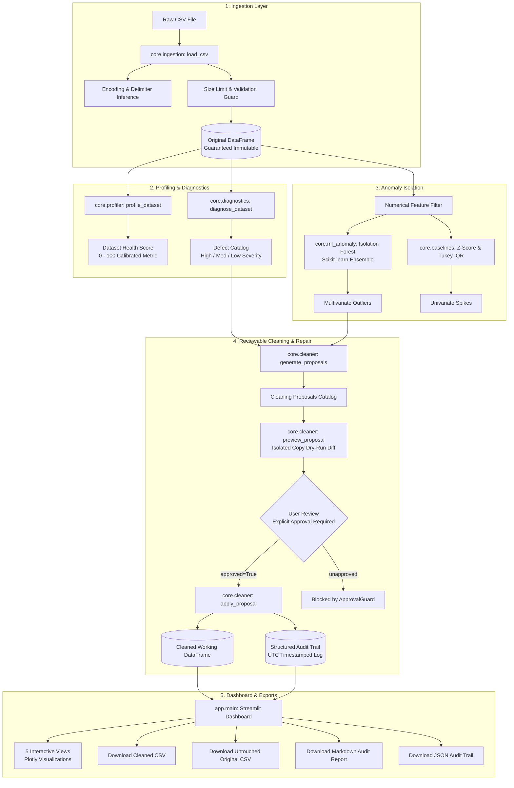

# DataDoctor AI 🩺

**DataDoctor AI** is an intelligent tabular dataset quality diagnosis, anomaly detection, and reviewable repair application built with Python, Scikit-learn, and Streamlit. Designed for high-integrity data engineering and machine learning workflows, it serves as an authentic AI/ML proof-of-work project for Cognext's *CognitionNext '26* technical screening.

Unlike automated cleaning tools that silently alter datasets or opaque LLM wrappers that hallucinate fixes, DataDoctor AI enforces strict mathematical transparency, unsupervised multidimensional outlier isolation, guaranteed dataset immutability, and an auditable governance protocol: **Diagnose -> Propose -> Preview -> Explicitly Approve -> Audit**.

---

## Architecture & System Pipeline



---

## Key Features

- **Resilient CSV Ingestion (`core/ingestion.py`)**:
  Auto-detects delimiters (`,`, `;`, `	`, `|`) and encodings (`utf-8`, `utf-8-sig`, `latin-1`). Enforces a 50 MB threshold, rejects binary corruptions, and protects untouched raw files.
- **Structural Profiling & Transparent Scoring (`core/profiler.py`, `core/diagnostics.py`)**:
  Calculates column-level sparsity, duplicates, distinctness, and semantic data types. Derives a deterministic Health Score (0–100) with calibrated deductions for missingness, duplication, and defect severity tiers.
- **Multidimensional Anomaly Detection (`core/ml_anomaly.py`, `core/baselines.py`)**:
  Unsupervised Scikit-learn Isolation Forest captures multi-feature correlation violations that classical 1D methods miss. Includes Gaussian Z-score ($|Z| > 3.0$) and Tukey's IQR fences ($k=1.5$) as baseline comparators.
- **Reviewable Cleaning & Dry-Run Preview (`core/cleaner.py`)**:
  Never modifies data silently. Generates structured proposals, displays dry-run diffs (row deltas and sample cell diffs) on isolated copies, and requires `approved=True` to execute.
- **Privacy-Preserving Audit Trail (`core/cleaner.py`, `app/utils/report_gen.py`)**:
  Maintains immutable UTC-timestamped audit records without storing sensitive cell values. Exports formatted Markdown audit reports and machine-readable JSON audit logs.
- **Zero-Cloud, 100% On-Premise Execution**:
  Zero external network calls, zero LLM APIs, zero data exfiltration.

---

## Technology Stack

| Layer | Technologies |
| :--- | :--- |
| **Language & Runtime** | Python 3.10+ (Tested & verified on Python 3.14.0 Windows AMD64) |
| **Data Processing** | Pandas (>=2.0.0), NumPy (>=1.24.0) |
| **Machine Learning** | Scikit-learn (>=1.4.0) — Isolation Forest ensemble |
| **Web Dashboard** | Streamlit (>=1.30.0) |
| **Data Visualization** | Plotly (>=5.18.0) |
| **Testing & Quality** | pytest (>=8.0.0) |

---

## Installation & Setup

### Option A: Windows PowerShell (Recommended)
```powershell
# Navigate into the project directory
cd "DataDoctor-AI"

# Create a local virtual environment
python -m venv .venv

# Activate the virtual environment
.\.venv\Scripts\Activate.ps1

# Install direct dependencies
pip install -r requirements.txt
```

### Option B: Windows Command Prompt (CMD)
```cmd
cd "DataDoctor-AI"
python -m venv .venv
.venv\Scriptsctivate.bat
pip install -r requirements.txt
```

---

## Quickstart: Launching the Application

Start the interactive dashboard with a single command:
```bash
streamlit run app/main.py
```
Open **`http://localhost:8501`** in your browser.

### Practical 5-Step Workflow:
1. **Load Data**: Upload a CSV via the sidebar, or click **"Load Sample Dirty Dataset"** for instant demonstration.
2. **Review Profile**: Navigate to **"2. Quality Profiling"** to view the Health Score (78.1/100.0), Plotly missingness charts, and the defect catalog.
3. **Isolate Anomalies**: In **"3. Anomaly Detection"**, configure the Isolation Forest or statistical baselines, select numerical features, and inspect the 2D bivariate scatter plot.
4. **Approve Repairs**: In **"4. Reviewable Cleaning"**, generate cleaning proposals, click **"Preview Changes"** to inspect dry-run diffs, and click **"Approve & Apply"**. Notice the Health Score rise to 93.8.
5. **Export & Audit**: In **"5. Export & Audit Reports"**, download the Cleaned CSV, Untouched Original CSV, Markdown Audit Report, and JSON Audit Log.

---

## Automated Test Verification

All 73 unit, integration, and UI tests pass with zero failures and zero warnings:

```bash
pytest -v
```

### Test Suite Coverage Breakdown:
| Test Suite | Tests | Scope Verified |
| :--- | :---: | :--- |
| `tests/test_ingestion.py` | 12 | Delimiter detection, encoding fallbacks (UTF-8, BOM, Latin-1), size limit guards, error raising |
| `tests/test_profiler.py` | 8 | Structural profile, missingness distribution, constant columns, type inference |
| `tests/test_diagnostics.py` | 9 | Defect catalog, currency type contamination, negative values, health score deductions |
| `tests/test_baselines.py` | 7 | Parametric Z-Score, Tukey's IQR fences, combination rules (any/all/majority) |
| `tests/test_ml_anomaly.py` | 8 | Isolation Forest fitting, contamination tuning, attribution scores, zero-variance handling |
| `tests/test_benchmark.py` | 5 | Deterministic synthetic benchmark generation, zero-division safeguards, evaluation metrics |
| `tests/test_cleaner.py` | 13 | Proposal generation, dry-run preview fidelity, approval requirement, double-apply guard, audit log |
| `tests/test_ui.py` | 10 | Plotly chart builders, Markdown audit report with comparisons, JSON audit serialization, CSV export fidelity |
| `tests/test_e2e.py` | 1 | Full end-to-end pipeline: load -> profile -> diagnose -> clean -> compare |
| **Total** | **73** | **100% Automated Test Suite Passing (31.93s)** |

---

## Empirical Anomaly Detection Benchmark

To ensure empirical honesty without fabricating metrics, DataDoctor AI includes a deterministic synthetic benchmark (`evaluation/synthetic_benchmark.py`, `evaluation/benchmark_runner.py`) comprising 1,000 samples and 100 ground-truth anomalies (40 univariate spikes, 40 correlation-violating outliers, and 20 low-density clusters).

Run the benchmark locally:
```bash
python evaluation/benchmark_runner.py
```

### Actual Measured Results (Python 3.14.0 on Windows AMD64):
| Method | Precision | Recall | F1-Score | Specificity | True Positives | False Positives | Latency (ms) |
| :--- | :---: | :---: | :---: | :---: | :---: | :---: | :---: |
| **Isolation Forest (ML)** | **0.7800** | **0.7800** | **0.7800** | **0.9756** | **78** | **22** | 1043.27 |
| **Z-Score Baseline (|Z| > 3.0)** | 1.0000 | 0.5800 | 0.7342 | 1.0000 | 58 | 0 | 37.52 |
| **Tukey's IQR Fencing (k=1.5)** | 0.8333 | 0.6000 | 0.6977 | 0.9867 | 60 | 12 | 26.49 |

### Empirical Insights & Algorithmic Trade-offs:
1. **Univariate Baselines (Z-Score, IQR)** execute in under 40 ms with zero or low false positives, but fail to detect correlation-violating outliers whose individual values remain within marginal fences (recall capped at 58%–60%).
2. **Isolation Forest** isolates multi-dimensional correlation violations that 1D methods miss (0.78 F1-score), but requires ~1,000 ms execution time and hyperparameter tuning.
3. **Synthetic vs. Real-World Disclosure**: Synthetic benchmarks demonstrate algorithmic trade-offs under known distributions; they do not establish identical accuracy across arbitrary real-world enterprise datasets.

---

## Profiling Issues vs. Statistical Anomalies

| Dimension | Profiling Issues (Rule-Based) | Statistical Anomalies (ML & Baselines) |
| :--- | :--- | :--- |
| **Nature** | Syntactic, structural, or domain rule violations. | Probabilistic deviations in numerical feature space. |
| **Examples** | Missing values, duplicate rows, currency text in numeric columns, negative age. | An observation where feature combinations are rare. |
| **Ground Truth** | Objectively defective according to data schema. | **Unusual, not automatically erroneous or fraudulent.** |
| **Detection** | Deterministic heuristics and pattern matching. | Unsupervised models (Isolation Forest, Z-Score, IQR). |
| **Governance** | Can be remediated deterministically (with user approval). | Must be reviewed in domain context; never purged silently. |

---

## Privacy & Responsible AI Statement

- **100% Local Execution**: No external telemetry, no remote API calls, no third-party data transfer.
- **Strict Immutability**: Original uploaded datasets are deep-copied into session state; source files on disk and original DataFrames are never modified in place.
- **Audit Logging**: Every applied operation generates a structured audit record with UTC timestamp and parameter details.
- **Sensitive Data Protection**: Audit logs and reports exclude full row contents by default.

---

## Project Documentation & Demonstration Materials

- **[Demo Presentation Script (3–5 Min)](docs/demo_script.md)**: Structured walkthrough for live technical presentations and evaluations.
- **[Screenshot Capture Checklist](docs/screenshot_checklist.md)**: Checklist of 7 high-resolution views for documentation and presentation slide decks.
- **[CognitionNext '26 Submission Summary](docs/cognition_next_submission.md)**: Complete proof-of-work assessment document detailing problem statement, technical contributions, measured results, and governance.

---

## Implemented vs. Deferred Scope

| Capability | Status | Implementation Details |
| :--- | :---: | :--- |
| Resilient CSV Ingestion & Encoding Inference | ✅ Implemented | `core/ingestion.py` |
| Structural Profiling & Calibrated Health Scoring | ✅ Implemented | `core/profiler.py`, `core/diagnostics.py` |
| Isolation Forest & Statistical Baselines | ✅ Implemented | `core/ml_anomaly.py`, `core/baselines.py` |
| Reproducible Synthetic Ground-Truth Benchmark | ✅ Implemented | `evaluation/benchmark_runner.py` |
| Reviewable Cleaning, Approval Guard & Audit Trail | ✅ Implemented | `core/cleaner.py` |
| Interactive Streamlit Web Dashboard | ✅ Implemented | `app/main.py`, `app/components/` |
| Cleaned CSV, Untouched CSV & Report Exporters | ✅ Implemented | `app/components/export_view.py`, `app/utils/report_gen.py` |
| Multi-User Auth & Role-Based Access Control | ⏳ Deferred | Out of scope for standalone screening MVP |
| Cloud Warehouse Connectors (Snowflake, BigQuery) | ⏳ Deferred | Planned for enterprise production extension |
| Distributed Big Data Engines (Spark / Dask) | ⏳ Deferred | Standalone architecture optimized for single-node memory |
